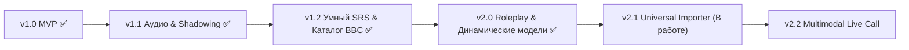

# Дорожная карта (Roadmap): English Fluency AI для Android

Нативное Android-приложение (**Kotlin + Jetpack Compose**) для развития беглости разговорного английского языка на базе уроков **BBC Learning English (6 Minute English)**, видео YouTube, статей и мультимодального ИИ **Google Gemini**.

---

## ✅ Часть 1. Реализовано и выпущено в релизах (v1.0 — v2.0)

### 🚀 Релиз v1.0 (MVP & Базовая архитектура)
- [x] **Импорт уроков BBC 6 Minute English:** скачивание веб-страницы выпуска и автоматическое извлечение темы, транскрипта, ключевых выражений, синонимов и вопросов через Gemini.
- [x] **Голосовой ИИ-тьютор (Push-to-Talk):**
  - Двойной захват речи: запись чистого `.m4a` AAC с микрофона + распознавание речи `SpeechRecognizer`.
  - Озвучка ответов тьютора через британский синтез `TextToSpeech` (`en-GB`).
- [x] **Многофакторный разбор каждого ответа (`SpeechAnalysis`):**
  - Target Vocabulary Check (отслеживание использования идиом из урока).
  - Native Phrasing («Как скажет носитель») с моментальной озвучкой.
  - Grammar & Accuracy (разбор грамматических нюансов на русском языке).
  - Pronunciation & Intonation (оценка в % и рекомендации).
  - Repeat Prompt («Повторить вслух») для закрепления эталонных фраз.
- [x] **Активный SRS-тренажер:** интервальное повторение (`1, 3, 7, 14, 30 дней`) в трех устных режимах: *RU → EN*, *EN → EN (Paraphrasing)*, *Situational Q&A*.
- [x] **Самообновление по воздуху (In-App OTA GitHub Updater):** проверка свежих версий прямо на GitHub Releases с установкой APK в 1 клик.
- [x] **Выбор моделей Gemini 3:** поддержка `gemini-2.5-flash`, `gemini-2.5-pro`, экспериментальных `gemini-3-flash-preview` и `gemini-3-pro-preview`.

### 🎧 Релиз v1.1 (Глубокая работа со звуком, IPA и Shadowing)
- [x] **Плеер собственного голоса («Послушай себя vs Эталон»):** прослушивание своей записи рядом с эталоном британского диктора.
- [x] **Пословный фонетический разбор (IPA Breakdown):** цветная подсветка слов, транскрипция в международном фонетическом алфавите IPA, комментарии по ударению и редукции.
- [x] **BBC Shadowing Deck:** тренажер синхронного повторения реплик ведущих BBC по транскрипту выпуска.
- [x] **100% Zero Static Content:** полный отказ от жестко закодированных уроков и списков слов в коде — всё генерируется и парсится динамически.
- [x] **Компактный Push-to-Talk UI:** однострочный выдвижной список целевых идиом `🎯 Слова (N/M) ▼` для максимизации полезного пространства экрана чата.
- [x] **Фирменная иконка приложения:** студийный микрофон BBC в палитре Union Jack со звуковой волной и AI-искрами.

### 🌐 Релиз v1.2 (Живой каталог BBC, Авто-ошибки и Динамический список моделей)
- [x] **Живой онлайн-каталог BBC 6 Minute English:** прямой парсинг свежих выпусков с сайта `bbc.co.uk` со встроенным поиском и скачиванием в 1 клик.
- [x] **Автоматический сбор личных ошибок («Мои слабые места»):** автоматическое добавление персональных грамматических и лексических ошибок из диалога в колоду SRS.
- [x] **Ежедневный 5-минутный голосовой спринт:** быстрый режим устной разминки из 5 карточек подряд.
- [x] **Динамический список моделей Gemini:** автоматическое получение доступных моделей пользователя напрямую через `GET /v1beta/models`.

### 🎭 Релиз v2.0 (Интерактивные ролевые симуляции Roleplay)
- [x] **Генерация реалистичных ролевых сценариев через ИИ:**
  - Тьютор входит в роль персонажа (коллега-разработчик на стендапе, скептичный менеджер, собеседующий в лондонском офисе, попутчик в пабе).
  - Студент получает уникальную роль и легенду ситуации на русском языке.
  - **Секретная миссия:** чек-лист из 3–5 целевых идиом, которые нужно естественно применить в разговоре.
  - ИИ отслеживает закрытие миссии и динамически подстраивает реплики.

---

## 🔮 Часть 2. В планах развития (Будущие версии)

### 📦 Этап 3 (v2.1) — Универсальный импортер источников (В работе ⏳)
- [ ] **Импорт уроков по ссылке на YouTube видео:**
  - Автоматическое извлечение субтитров и транскрипта (`timedtext`).
  - Генерация интерактивного урока через Gemini: словарь, ключевые фразы, реплики для шедоуинга, вопросы.
- [ ] **Импорт любых веб-статей (Jsoup):**
  - Поддержка произвольных ссылок на статьи (Medium, The Guardian, TechCrunch, Substack, Wikipedia).
  - Извлечение чистого текста без рекламы и меню, формирование словарной базы и разговорных тем.
- [ ] **Импорт из своих заметок и текста:**
  - Вставка любого пользовательского текста (рабочий email, транскрипт созвона, заметки к выступлению) для экспресс-подготовки к реальному разговору.

### ⚡ Этап 4 (v2.2) — Непрерывный Live-звонок (Gemini Multimodal Live)
- [ ] **Режим живого телефонного звонка (WebSockets):**
  - Непрерывный разговор без удерживания кнопок (Full Duplex Streaming).
  - Прямой стриминг аудио с микрофона в Gemini Live API и прием синтезированного ответа в реальном времени.
  - Формирование сводного детального отчета с разбором ошибок после завершения звонка.

### 📊 Этап 5 (v2.3) — Аналитика беглости и геймификация
- [ ] **Графики беглости речи:** динамика темпа говорения (слов в минуту), коэффициента ошибок и активного словарного запаса.
- [ ] **Экспорт персонального словаря:** выгрузка в Anki (.apkg), CSV или Notion.
